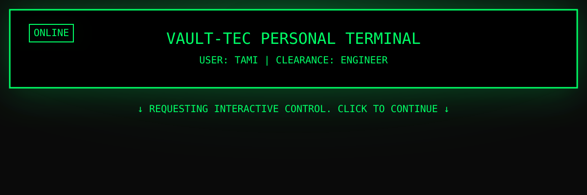
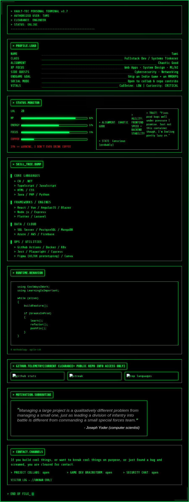

<div align="center">

<a href="https://tamiloreo.github.io/TamiloreO/" target="_blank">

  

  

  

</a>

</div>

# Extensive Portfolio

My personal site. It started as a Fallout-style Vault-Tec terminal that boots in the browser, and it is being rebuilt as an explorable 3D world where visitors walk around with a playable character and interact with the things I have built.

**Live:** https://tamiloreo.github.io/TamiloreO/

## Status

| Version | State | What it is |
| --- | --- | --- |
| v1 | Live | A single-page terminal: boot sequence, profile, and project listings in a CRT-styled shell. Plain HTML, CSS and a little JavaScript, no build step. |
| v2 | In progress | A 3D, MMO-style version of the same site. A playable character walks a small world, and each project or technology is something you can walk up to and interact with. See [ROADMAP.md](ROADMAP.md). |

## Who it is for

Me first: it is the page I point people at when they ask what I work on. It is also a place to try interface ideas that are too odd for a client project, which is why the styling leans so hard into the terminal look.

## Built with

- **v1:** hand-written HTML, CSS and vanilla JavaScript, served as a static site from GitHub Pages. The preview image is refreshed by a GitHub Action and committed by a bot, which is why most of the commits in this repository are automated.
- **v2 (planned):** TypeScript, [Three.js](https://threejs.org/) for rendering, [Rapier](https://rapier.rs/) for collision, Vite as the build tool. The plan and the reasoning behind it are in [ROADMAP.md](ROADMAP.md).

## Run it locally

The v1 site is static, so any static server works:

```bash
git clone https://github.com/TamiloreO/TamiloreO.git
cd TamiloreO
python3 -m http.server 8000 --directory website
```

Then open http://localhost:8000. Opening `website/index.html` straight from disk mostly works too, but the boot sound and the font request behave better over HTTP.

The site is deployed to GitHub Pages by `.github/workflows/deploy-pages.yml` on every push to `main`.

## Repository layout

```
.
├── website/            # the v1 site: index.html, style.css and the assets it loads
├── assets/             # banners, preview image and scanline art used by this README
└── .github/workflows/  # Pages deploy, and the preview-image refresh
```

## What is next

[ROADMAP.md](ROADMAP.md) tracks the v2 build in phases: the 3D shell, a controllable character, the explorable hub, interactable project stations, a turn-based mini-game, then the mobile and accessibility pass. Open issues carry the smaller items.

## License

[MIT](LICENSE) © Oluwatamilore Olufohunsi
